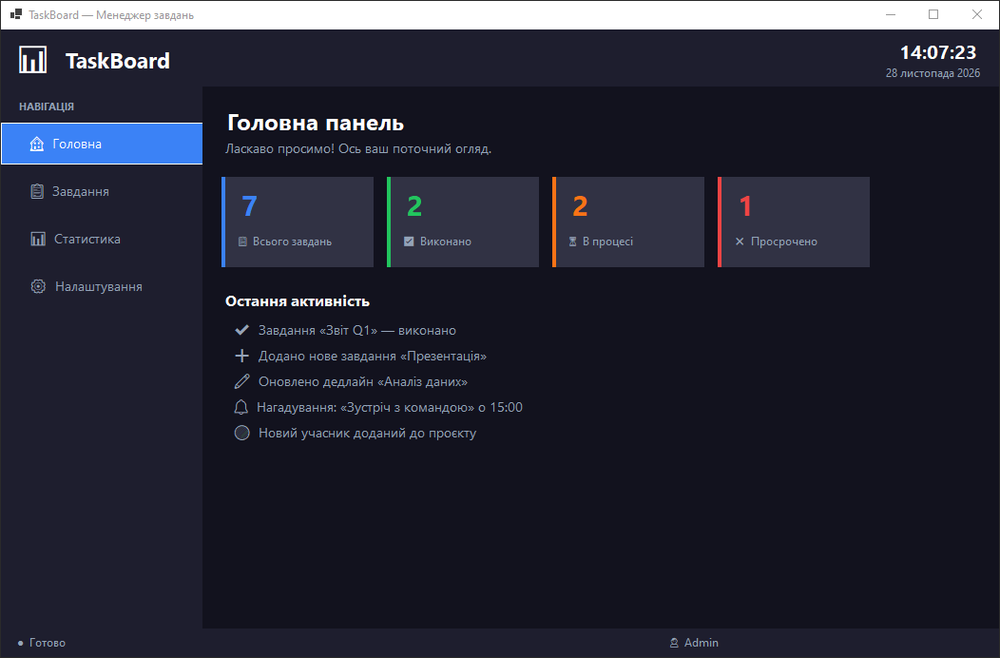
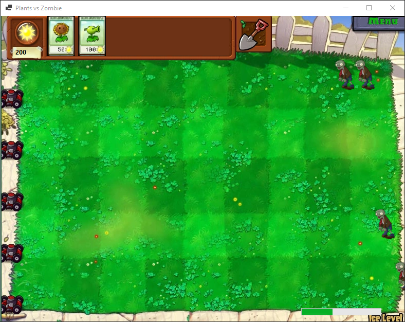
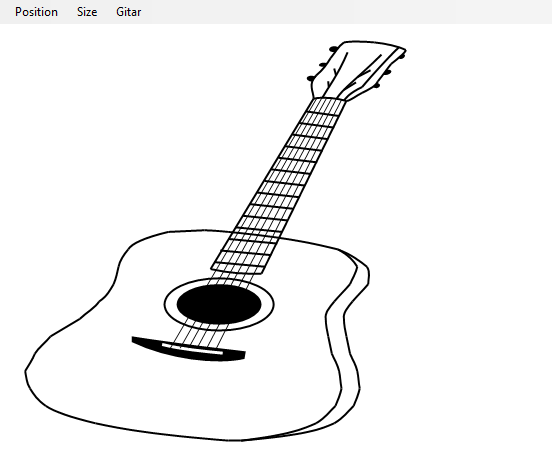
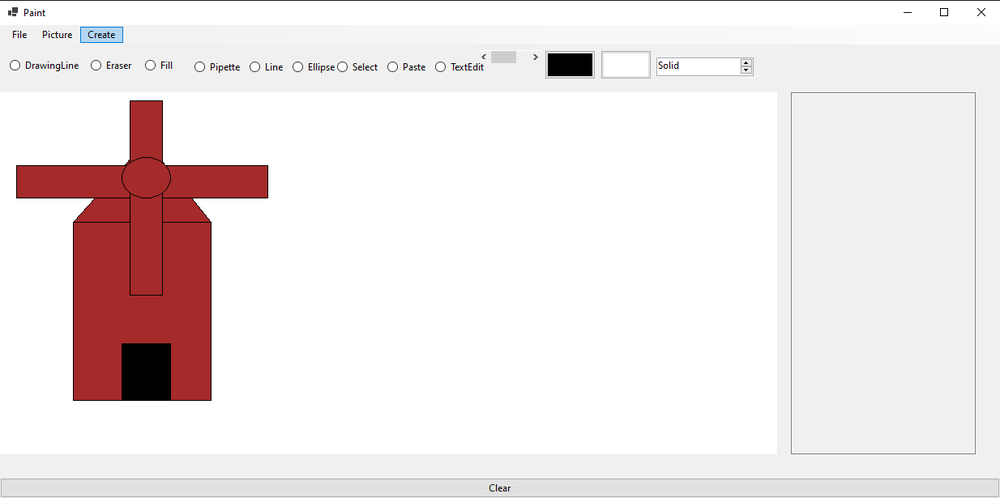
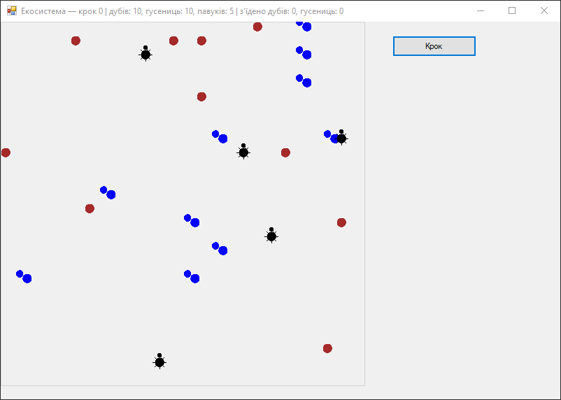
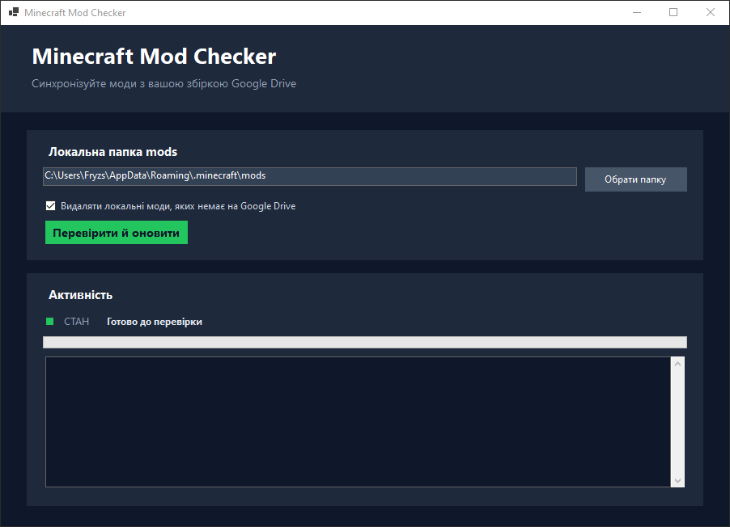

  

  

---

## ✨ Featured projects

<table>
  <tr>
    <td width="50%" valign="top">
      
      <h3><a href="https://github.com/Fryzs/TaskBoard">📋 TaskBoard</a></h3>
      A task manager dashboard with a dark theme: tasks with priorities and deadlines, live stats, quick editing.
    </td>
    <td width="50%" valign="top">
      
      <h3><a href="https://github.com/Fryzs/Plants-vs-Zombie">🌱 Plants vs Zombie</a></h3>
      A small tower-defense game: plant sunflowers and pea shooters, hold the lawn against waves of zombies.
    </td>
  </tr>
  <tr>
    <td width="50%" valign="top">
      
      <h3><a href="https://github.com/Fryzs/Gitar">🎸 Gitar</a></h3>
      A guitar drawn with Bézier curves — pluck a string and hear the note.
    </td>
    <td width="50%" valign="top">
      
      <h3><a href="https://github.com/Fryzs/lb10-11">🎨 Raster editor</a></h3>
      A Paint-like editor: pencil, shapes, fill, pipette, text, copy &amp; paste and undo.
    </td>
  </tr>
  <tr>
    <td width="50%" valign="top">
      
      <h3><a href="https://github.com/Fryzs/PR8">🌍 Ecosystem simulation</a></h3>
      Oaks, caterpillars and spiders living, breeding and eating each other step by step.
    </td>
    <td width="50%" valign="top">
      
      <h3><a href="https://github.com/Fryzs/MinecraftModCheker">🔄 Mod Checker</a></h3>
      Keeps a game client's mods folder in sync with a shared modpack — checks hashes, downloads only what changed.
    </td>
  </tr>
</table>

## 🧩 Design patterns

<b>A set of small apps, one classic pattern each</b> — click to expand

 

| 🏗️ Creational | 🧱 Structural | 🔁 Behavioral |
| --- | --- | --- |
| [Abstract Factory](https://github.com/Fryzs/KPZ_LB_1) | [Adapter](https://github.com/Fryzs/Adapter) | [Chain of Responsibility](https://github.com/Fryzs/Lb88) |
| [Factory Method](https://github.com/Fryzs/KPZ_LB_2) | [Composite](https://github.com/Fryzs/Composite) | [Command](https://github.com/Fryzs/lb122) |
| [Builder & Prototype](https://github.com/Fryzs/Builder) | [Decorator](https://github.com/Fryzs/Decorator) | [Mediator](https://github.com/Fryzs/lb133) |
| [Singleton](https://github.com/Fryzs/Singelton) | [Flyweight](https://github.com/Fryzs/Flyweight) | [Observer](https://github.com/Fryzs/Lb111) |
| | [Proxy](https://github.com/Fryzs/Proxy) | [State](https://github.com/Fryzs/State) |
| | | [Strategy](https://github.com/Fryzs/lb1222) |
| | | [Template Method](https://github.com/Fryzs/Template) |
| | | [Visitor](https://github.com/Fryzs/lb188) |

## 🛠️ Other bits

| Project | What it does |
| --- | --- |
| [Figures editor](https://github.com/Fryzs/PR3) | Draw, move and resize shapes; areas are calculated live |
| [SqlTEST](https://github.com/Fryzs/SqlTEST) | Runs parameterized queries against a local MySQL database |
| [Shoe catalog](https://github.com/Fryzs/WindowsFormsApp1) | A small product catalog backed by an Access database |
| [Export to Excel](https://github.com/Fryzs/lb_13ex) · [Word](https://github.com/Fryzs/lb_13word) | Moves table data to and from Office documents |
| [Login with roles](https://github.com/Fryzs/Lb_15) | Sign-in with admin / user roles and user management |
| [Dots](https://github.com/Fryzs/Dods) · [Fractions](https://github.com/Fryzs/PR5) | Console games and exercises in C++ |

Thanks for stopping by ✌️

